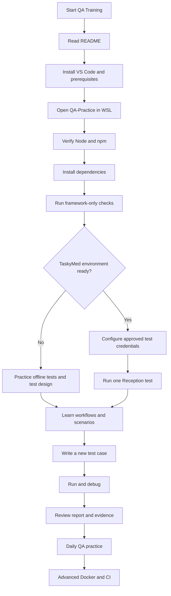
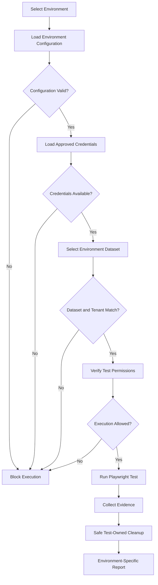

# TaskyMed Essential QA

This is an independent Playwright + TypeScript test project for TaskyMed Health OS. Playwright drives browsers and APIs; TypeScript checks the test code before it runs. The framework covers verified workflows, Essential-plan entitlement checks, safety boundaries, API probes, browser projects and reporting. It never changes TaskyMed application repositories or infrastructure.

## Contents

- [Start here](#start-here)
- [Learning roadmap](#learning-roadmap)
- [Quick Start](#quick-start)
- [Install and configure](#install-and-configure)
- [Run tests](#run-tests)
- [Project Folder and File Guide](#project-folder-and-file-guide)
- [Execution flow](#execution-flow)
- [Add a scenario and test case](#add-a-scenario-and-test-case)
- [Docker and CI](#docker-and-ci)
- [Current implementation and blockers](#current-implementation-and-blockers)



This is the conceptual learning path. The application path may stop at offline practice when readiness, credentials or an Essential fixture is unavailable.

Environment selection uses one complete context. The selected environment controls the URL, tenant, facility, credential scope, dataset, Essential license profile, allowed suites, cleanup policy and report namespace.



No application-changing request should occur before these checks succeed.

## Start here

A workflow is a business activity, such as Patient Registration. A scenario is a behavior within it, such as valid registration. A test case gives the exact data, steps and expected result. A Playwright test is the executable implementation. Suites such as `@smoke` and `@regression` select the same test without duplicating code.

Begin with [docs/01-GETTING-STARTED.md](docs/01-GETTING-STARTED.md), then [docs/02-QA-FUNDAMENTALS.md](docs/02-QA-FUNDAMENTALS.md). Continue with [docs/03-PLAYWRIGHT-TYPESCRIPT.md](docs/03-PLAYWRIGHT-TYPESCRIPT.md), [docs/04-TASKYMED-PRACTICAL-TESTING.md](docs/04-TASKYMED-PRACTICAL-TESTING.md), [docs/05-ADVANCED-QA-ENGINEERING.md](docs/05-ADVANCED-QA-ENGINEERING.md), [docs/06-DAILY-QA-WORKFLOW.md](docs/06-DAILY-QA-WORKFLOW.md), [docs/07-QA-TERMINOLOGY-QUICK-REFERENCE.md](docs/07-QA-TERMINOLOGY-QUICK-REFERENCE.md) and [docs/08-QA-INTERVIEW-QUESTIONS-ANSWERS.md](docs/08-QA-INTERVIEW-QUESTIONS-ANSWERS.md).

Follow the seven-day plan in `06-DAILY-QA-WORKFLOW.md`. Daily sprint work and reusable evidence templates are included in `06-DAILY-QA-WORKFLOW.md`.

## Learning roadmap

1. **Manual QA foundations:** SDLC/STLC, Agile/Scrum, requirements, acceptance criteria, workflows, scenarios, cases, positive/negative/boundary tests, severity/priority, defects and reporting.
2. **Playwright and TypeScript:** Node/npm, types, browser/context/page, locators, assertions, fixtures, POM, APIs, traces and reports.
3. **TaskyMed automation:** Reception and Physician workflows, synthetic data, roles, Essential entitlements, safe cleanup and regression evidence.
4. **Professional QA engineering:** browsers, mobile web, accessibility, security, timing, Docker, CI, environments, flakiness and release readiness.

Stages 1–2 do not require a running TaskyMed application. Use the offline catalog, framework checks and test-design exercises first.

## Quick Start

# Run in WSL Ubuntu or a VS Code WSL terminal.

```bash
cd /mnt/d/workdir/health-care/TASKYMED/QA-Practice
npm ci
npx playwright install
npm run check
npm run test:unit
npm run test:list
npm run test:framework
```

`npm run verify:env` validates the selected environment. Use an approved ignored template, for example `QA_ENV_FILE=framework/config/environments/local.env npm run verify:env`. The framework-only browser case can run without TaskyMed; UI/API workflow tests require a reachable approved environment and Essential fixture.

Run an approved application smoke suite only after readiness and credentials are verified:

```bash
npm run test:smoke
```

Open an existing HTML report with `npm run test:report`; debug with `npm run test:debug` or `npm run test:ui`.

## Install and configure

```bash
cp framework/config/environments/local.env.example framework/config/environments/local.env
cp .env.example .env
npm run lint
npm run verify:env
```

Use only approved non-production values in `.env`. Never commit credentials, tokens, storage state or PHI. `QA_ENV=production` is read-only and fail-closed. There is no credential, dataset or URL fallback between environments; missing selected-environment values block execution.

Environment matrix: LOCAL uses `http://taskymed.local` only after routing is verified. DEV, QA, POC, UAT and PRODUCTION require their existing approved URLs and identifiers; this repository does not invent them. `https://taskymed.amroth.life` is currently **UNCLASSIFIED** because DNS resolution failed during the safe read-only check. It cannot be used for authenticated or state-changing tests until its environment, tenant and authorization are verified.

## Run tests

```bash
npm run test:list
npm run test:smoke
npm run test:api
npm run test:workflow -- reception
npm run test:workflow -- physician
npm run test:licensing
npm run test:regression
npm run test:mobile
npm run test:cross-browser
npm run test:responsive
npm run test:response-time
npm run suite:audit
npm run test:report
```

`npm run cleanup:dry-run` never deletes data. Use `npm run test:last-failed` and `npm run trace` for failures. `npm run test:unit` checks catalog governance. `npm run test:report` opens an existing Playwright HTML report; it does not generate a report by itself.

Windows PowerShell is appropriate for Windows-specific diagnostics. Use WSL for normal Node/npm/Playwright commands; a PowerShell command and a WSL command do not necessarily resolve paths or services identically.

## Project Folder and File Guide

| Folder/File                      | What it does                                             | When to open it              |
| -------------------------------- | -------------------------------------------------------- | ---------------------------- |
| `tests/`                         | Playwright specs                                         | Writing or running tests     |
| `tests/reception/`               | Reception workflow tests                                 | Patient registration         |
| `tests/physician/`               | Physician workflow tests                                 | Queue visibility             |
| `tests/licensing.spec.ts`        | Essential license case                                   | Subscription restrictions    |
| `tests/api.spec.ts`              | Read-only API check                                      | API behavior                 |
| `tests/accessibility.spec.ts`    | Accessibility check                                      | Accessibility work           |
| `tests/reliability.spec.ts`      | Failure/timing diagnostic                                | Recovery work                |
| `framework/pages/`               | Reusable Page Object Models                              | Shared UI interactions       |
| `framework/support/test.ts`      | Shared `test.extend()` fixtures                          | Test setup                   |
| `framework/support/api.ts`       | Thin APIRequestContext wrapper                           | API setup or verification    |
| `framework/support/data.ts`      | Synthetic data and dry-run cleanup lifecycle             | Test data and teardown       |
| `framework/support/safety.ts`    | State-change and production guard                        | Any mutating test            |
| `framework/support/test.ts`      | Fixtures plus route/timing diagnostics                   | Test setup and reliability   |
| `framework/config/`              | Environment, browser, suite policy and dataset manifests | Execution changes            |
| `framework/catalog/catalog.yaml` | Workflow/scenario/case source of truth                   | Coverage changes             |
| `framework/scripts/`             | Verification, suite selection and reporting commands     | Automation maintenance       |
| `playwright.config.ts`           | Projects, reporters, traces and timeouts                 | Playwright execution changes |
| `package.json`                   | npm commands and dependencies                            | Installation or commands     |
| `package-lock.json`              | Exact dependency versions                                | Reproducible installation    |
| `.env.example`                   | Concise pointer to the selected ignored environment file | Environment setup            |
| `framework/config/environments/` | Explicit environment templates                           | Selecting a target           |
| `framework/config/datasets/`     | Environment-bound synthetic dataset manifests            | Checking dataset ownership   |
| `Dockerfile`                     | Pinned Playwright container                              | Docker execution             |
| `compose.yaml`                   | Container/report configuration                           | Docker Compose               |
| `.github/workflows/`             | PR and nightly CI                                        | CI changes                   |
| `docs/`                          | Beginner and operational guides                          | Learning or handoff          |
| `CONTRIBUTING.md`                | Self-documenting-file and review rules                   | Before making changes        |

Key training guides: `docs/06-DAILY-QA-WORKFLOW.md`, `docs/07-QA-TERMINOLOGY-QUICK-REFERENCE.md` and `docs/08-QA-INTERVIEW-QUESTIONS-ANSWERS.md`. URL troubleshooting is included in `05-ADVANCED-QA-ENGINEERING.md`.

JSON files such as `package.json` and `tsconfig.json` intentionally contain no comments; this guide documents them instead.

### File origin and editability guide

The maintainer field identifies the repository maintainer for this project; it is not a claim that the maintainer personally authored every historical line.

| File                                  | Purpose                                             | Origin                                                     | Generated by/command                                                      | Maintained by               | Editable?                          |
| ------------------------------------- | --------------------------------------------------- | ---------------------------------------------------------- | ------------------------------------------------------------------------- | --------------------------- | ---------------------------------- |
| `package.json`                        | npm scripts and dependency declarations             | Manually maintained JSON                                   | No comment-safe generator; `npm init` is not claimed                      | Lakshmikiran J.             | Yes, review scripts/dependencies   |
| `package-lock.json`                   | Exact npm dependency graph                          | Tool-generated lockfile; history not individually verified | `npm install` when dependencies legitimately change; `npm ci` consumes it | Lakshmikiran J. through npm | Do not hand-edit                   |
| `tsconfig.json`                       | Strict TypeScript compiler rules                    | Manually maintained JSON                                   | No verified generator command                                             | Lakshmikiran J.             | Yes, carefully                     |
| `playwright.config.ts`                | Projects, timeouts, reporters and artifacts         | Manually maintained                                        | Browser binaries are installed separately                                 | Lakshmikiran J.             | Yes, with safety review            |
| `framework/config/environments.ts`    | Typed environment and fail-closed validation        | Manually maintained                                        | None                                                                      | Lakshmikiran J.             | Yes, never weaken guards           |
| `framework/config/browsers.ts`        | Browser/device project matrix                       | Manually maintained                                        | Uses native Playwright `devices`; no Codegen claim                        | Lakshmikiran J.             | Yes, after support review          |
| `framework/config/suite-policy.ts`    | Suite tags and environment policy                   | Manually maintained                                        | None                                                                      | Lakshmikiran J.             | Yes, with catalog review           |
| `framework/catalog/catalog.yaml`      | Workflow/scenario/test-case source of truth         | Manually maintained YAML                                   | Parsed by `npm run verify:catalog`                                        | Lakshmikiran J.             | Yes, preserve stable IDs           |
| `framework/config/datasets/*.json`    | Environment-bound synthetic dataset manifests       | Manually maintained strict JSON                            | Loaded by `framework/config/environments.ts`                              | Lakshmikiran J.             | Yes, placeholders only             |
| `tests/**/*.spec.ts`                  | Executable Playwright specifications                | Manually maintained; not claimed as Codegen output         | Native Playwright CLI runs them                                           | Lakshmikiran J.             | Yes, preserve assertions/safety    |
| `framework/pages/*.ts`                | Small reusable Page Objects                         | Manually maintained                                        | No Playwright Codegen history claimed                                     | Lakshmikiran J.             | Yes, when UI contract is verified  |
| `framework/support/*.ts`              | Fixtures, API, data, safety and diagnostics         | Manually maintained                                        | None                                                                      | Lakshmikiran J.             | Yes, preserve isolation            |
| `framework/scripts/*.ts`              | Catalog, environment, suite and report commands     | Manually maintained                                        | None; npm scripts invoke them                                             | Lakshmikiran J.             | Yes, with command tests            |
| `Dockerfile`                          | Pinned Playwright runner image                      | Manually maintained Dockerfile                             | `docker compose build` consumes it                                        | Lakshmikiran J.             | Yes, review image alignment        |
| `compose.yaml`                        | Container networking, variables and artifact mounts | Manually maintained YAML                                   | Docker Compose reads it                                                   | Lakshmikiran J.             | Yes, never add secret defaults     |
| `.github/workflows/*.yml`             | CI workflow definitions                             | Manually maintained YAML                                   | GitHub Actions executes them; no hosted run is claimed                    | Lakshmikiran J.             | Yes, review protected environments |
| `.env.example`                        | Safe variable-name template                         | Manually maintained template                               | `cp .env.example .env` is a learner action                                | Lakshmikiran J.             | Yes, placeholders only             |
| `docs/*.md`                           | Learning and operational guidance                   | Manually maintained Markdown                               | No generator claimed                                                      | Lakshmikiran J.             | Yes, keep claims evidence-based    |
| `artifacts/audits/*.md`               | Audits and verification evidence                    | Manually maintained evidence reports                       | Reports may summarize tool output; no automatic generation is claimed     | Lakshmikiran J.             | Add/update when audits change      |
| `node_modules/`                       | Installed third-party dependencies                  | Tool-generated and ignored                                 | `npm ci`                                                                  | npm                         | No                                 |
| `test-results/`, `playwright-report/` | Generated test artifacts                            | Automatically generated and ignored                        | Playwright reporters during test execution                                | Playwright                  | No; delete/regenerate safely       |
| Browser binaries/cache                | Installed Playwright browsers                       | Tool-generated outside source ownership                    | `npm run install:browsers` or CI `npx playwright install --with-deps ...` | Playwright                  | No; reinstall when versions change |

No file is claimed to have been generated by Playwright Codegen unless a verified Codegen command and output history exists.

## Environment, dataset and suite command matrix

Copy only the selected template to its ignored `.env` counterpart. `framework/config/environments.ts` loads the selected file when `QA_ENV_FILE` is set, then validates the matching dataset manifest. Do not copy credentials between environments.

| Environment | Template                                                    | Dataset manifest                                                    | Credentials                | Allowed suites                           | Example command                                                             |
| ----------- | ----------------------------------------------------------- | ------------------------------------------------------------------- | -------------------------- | ---------------------------------------- | --------------------------------------------------------------------------- |
| LOCAL       | `framework/config/environments/local.env.example`           | `framework/config/datasets/local.json` — unavailable until approved | LOCAL role variables only  | Smoke/API/regression                     | `QA_ENV_FILE=framework/config/environments/local.env npm run test:smoke`    |
| DEV         | `framework/config/environments/dev.env.example`             | `framework/config/datasets/dev.json` — unavailable                  | DEV role variables only    | Smoke/API/functional/regression          | `QA_ENV_FILE=framework/config/environments/dev.env npm run test:functional` |
| QA/TEST     | `framework/config/environments/qa.env.example`              | `framework/config/datasets/qa.json` — unavailable                   | QA role variables only     | Smoke/API/functional/regression/security | `QA_ENV_FILE=framework/config/environments/qa.env npm run test:regression`  |
| POC         | `framework/config/environments/poc.env.example`             | `framework/config/datasets/poc.json` — unavailable                  | POC role variables only    | Smoke/functional after approval          | `QA_ENV_FILE=framework/config/environments/poc.env npm run test:smoke`      |
| UAT         | `framework/config/environments/uat.env.example`             | `framework/config/datasets/uat.json` — unavailable                  | UAT role variables only    | Smoke/regression/UAT after approval      | `QA_ENV_FILE=framework/config/environments/uat.env npm run test:uat`        |
| PERF        | `framework/config/environments/perf.env.example` — disabled | No PERF dataset                                                     | None                       | No execution until approved              | No command; intentionally blocked                                           |
| PRODUCTION  | `framework/config/environments/production.env.example`      | `framework/config/datasets/production.json` — read-only/unavailable | Production monitoring only | Explicit read-only policy                | No state-changing command                                                   |

Templates contain placeholders, not real endpoints or credentials. `http://taskymed.local` remains the preferred LOCAL URL but is unverified. `https://taskymed.amroth.life` remains unclassified and is not mapped to any template.

### Browser and device projects

The actual projects are defined only in `framework/config/browsers.ts`:

| Project         | Browser/device                    | Command                                         |
| --------------- | --------------------------------- | ----------------------------------------------- |
| `chromium`      | Desktop Chrome                    | `npx playwright test --project=chromium --list` |
| `firefox`       | Desktop Firefox                   | `npx playwright test --project=firefox --list`  |
| `webkit`        | Desktop Safari/WebKit             | `npx playwright test --project=webkit --list`   |
| `mobile-chrome` | Pixel 5 mobile Chrome emulation   | `npm run test:mobile`                           |
| `mobile-safari` | iPhone 13 mobile Safari emulation | `npm run test:mobile`                           |
| `tablet`        | iPad generation 7 emulation       | `npx playwright test --project=tablet --list`   |

Use `npm run suite:audit` to see each suite’s selection command, matching specs/tests, last verified framework execution and blocker. A suite with no matching tag is reported as `NOT IMPLEMENTED — NO MATCHING TESTS`, not as passing coverage.

## Execution flow

```text
Playwright Command
        |
        v
playwright.config.ts
        |
        v
Test File (.spec.ts)
        |
        v
Shared Fixture (framework/support/test.ts)
        |
        v
Page Object / API Helper
        |
        v
TaskyMed Application
        |
        v
Playwright Assertions
        |
        v
Safe Cleanup
        |
        v
Test Report
```

For the registration example, `registration-positive.spec.ts` imports `framework/support/test.ts`, generates synthetic values through `framework/support/data.ts`, checks `framework/support/safety.ts`, opens the Reception route and asserts the route. It does not claim patient persistence until the approved setup and cleanup contract exists. API-only tests may skip the browser path.

## Add a scenario and test case

1. Find the workflow in `framework/catalog/catalog.yaml`, for example `ESS-REC-REG`.
2. Check whether the scenario already exists.
3. Add a new stable scenario ID such as `ESS-REC-REG-S003` if needed.
4. Add a case such as `ESS-REC-REG-S003-TC001`, its `automatedFile`, environments and `status`.
5. Create or extend a readable spec under `tests/reception/`.
6. Add tags such as `@functional @regression` to the test title.
7. Run `npm run catalog:validate`.
8. Run `npm run test:workflow -- reception` or a narrower Playwright grep.
9. Inspect the report and record PASS, FAIL, BLOCKED or NOT RUN accurately.

Important catalog fields: `id` is stable; `workflowId` and `scenarioId` identify parents; `name` and `workspace` describe the business area; `entitlement` and `authorizedRoles` describe access; `risk` and `priority` guide focus; `applicableEnvironments` and `environments` describe allowed targets; `classification` describes positive/negative/boundary behavior; `suites` selects execution; `automatedFile` links code; `status` describes discovery/implementation state. `discovered` does not mean tested, `automated` does not mean passed, `blocked` does not mean failed, and PASS requires execution evidence.

## Docker and CI

```bash
docker compose build
docker compose run --rm qa npm run test:smoke
docker compose run --rm qa npm run test:api
```

GitHub Actions lives in `.github/workflows/`. Pull requests run static gates and approved safe suites; nightly uses protected QA secrets. QA-Practice does not deploy or provision OCI infrastructure.

Docker requires the same explicit environment contract as host execution. It fails rather than defaulting to another URL when required variables are missing. WSL environment variables are not automatically copied into a container; use approved `.env` or CI environment injection.

## Opening TaskyMed locally

The canonical human-readable URL is `http://taskymed.local`. It is currently **UNVERIFIED**: no listener or hosts/DNS entry was observed during the audit. Do not assume it works. Follow the troubleshooting section in `docs/05-ADVANCED-QA-ENGINEERING.md`, verify readiness, then place the approved URL in `QA_UI_BASE_URL` and `QA_API_BASE_URL`. Do not edit hosts files or application configuration without authorization.

## Current implementation and blockers

Implemented: typed environment safety, production fail-closed behavior, workflow catalog governance, Playwright projects, API abstraction, synthetic data factory, dry-run cleanup, Docker configuration, CI workflows, reports, traces, suite-policy/audit selection, controlled timing summarization and beginner documentation. The framework-only typecheck, lint, catalog validation, unit/isolation tests, formatting, suite audit and Playwright discovery have been verified.

Blocked or not verified: `http://taskymed.local` currently has no observed DNS/hosts entry or listener; full application UI/API execution therefore needs an approved local routing/readiness setup. Essential licensing also lacks an approved Essential credential/license fixture, and Docker browser/GitHub Actions execution remain unverified. The inspected local tenant is `plan_pro`, not Essential. Live response-time baselines are not established; the timing suite currently verifies sample summarization only. Run `npm run suite:audit` to see which suites have matching specs. See `artifacts/audits/QA-ADDENDUM-49B-GAP-MATRIX.md`, `artifacts/audits/FINAL-IMPLEMENTATION-REPORT.md` and `artifacts/audits/ENTITLEMENT-MATRIX.md`.
