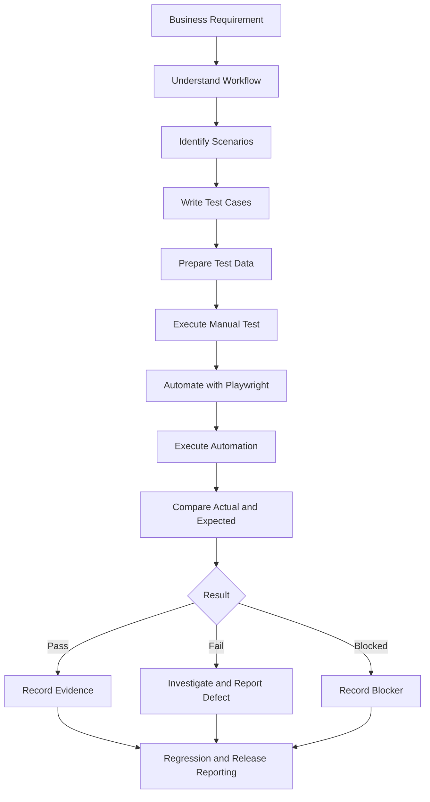

# 02 — QA fundamentals

## From requirement to evidence

For TaskyMed, “register a patient” is the workflow. “Required fields reject incomplete input” is a scenario. `ESS-REC-REG-S002-TC001` is a concrete case. The `.spec.ts` is the test script, `@functional` is suite metadata, the test run is one execution, and the report records evidence.

## Manual QA and Agile

SDLC is the software development life cycle; STLC is the testing life cycle. In a Scrum sprint, QA reviews the story and acceptance criteria, identifies risk and scenarios, prepares data, executes tests, reports defects, retests fixes and contributes evidence to the release decision. Smoke checks critical availability; sanity checks a focused change; functional tests requirements; regression checks previously working behavior.

Use positive, negative and boundary cases. Equivalence partitioning groups similar inputs; boundary-value analysis targets edges; decision tables cover combinations; state-transition tests cover status changes; exploratory testing learns the product while probing risk. Severity describes impact; priority describes urgency.

## Defects and evidence

A defect report needs environment, role, tenant/facility, case ID, preconditions, exact steps, expected/actual result, reproducibility, severity, priority and trace/screenshot/request evidence. A BLOCKED result means a prerequisite prevented execution; it is not a failed assertion or a pass.

## Deliverables

Typical sprint artifacts are a scenario inventory, test plan, test cases, execution log, defect list, daily status, sprint summary and release recommendation. Use the templates and routine in `06-DAILY-QA-WORKFLOW.md`.
